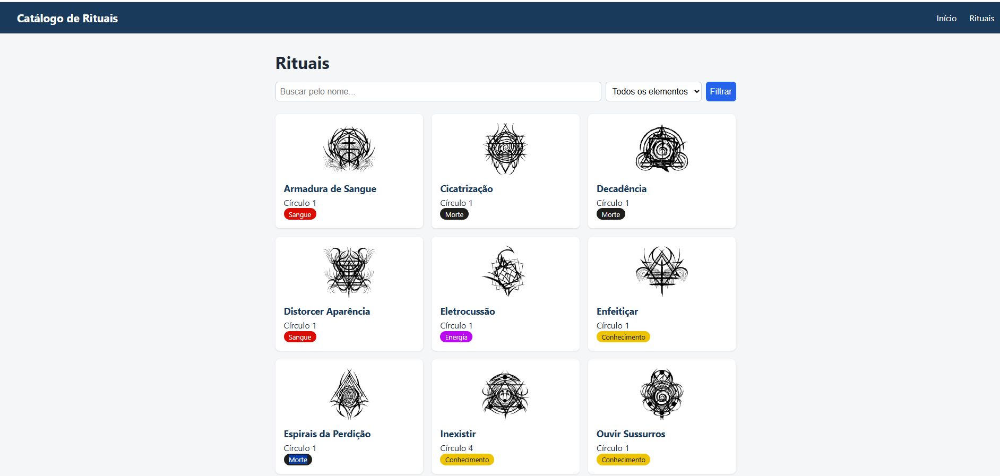
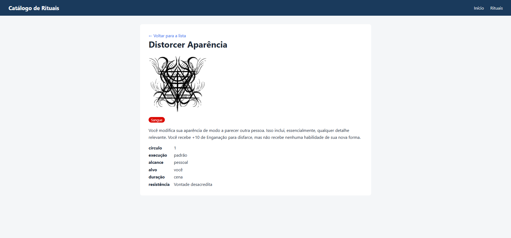

Este projeto é um catálogo de rituais do jogo Ordem Paranormal RPG.

Para rodar o projeto é necessário executar os seguintes comandos:
```
npm install
npm run seed
npm run dev
```
após isso, entre no navegador usando o URL http://localhost:3000

prints das páginas:

Lista:


Filtro de pesquisa:


Filtro por elemento:


Um ritual detalhado:


Melhoria feita:
A melhoria feita foi a adição de imagens para cada ritual.